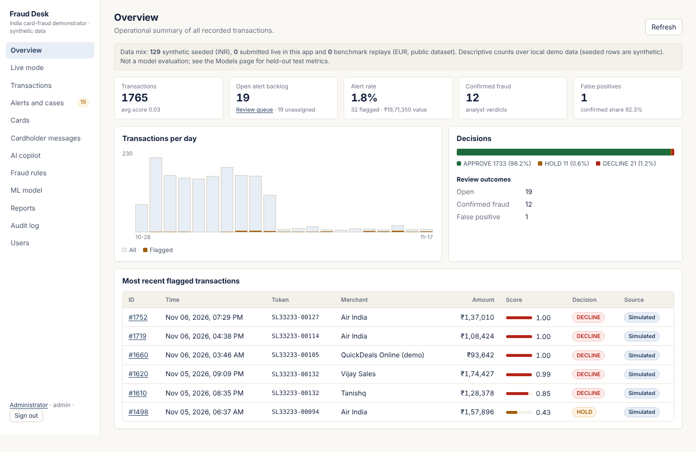

# Fraud Desk — credit card fraud review demonstrator (India)

A Software Engineering Lab project (CIC-357): a card-fraud desk that scores a stream of Indian transactions with a trained model, blocks the obvious fraud on its own, messages cardholders, closes the cases they answer, and sends only the grey cases to a human analyst. FastAPI + SQLite back end, React/TypeScript console, XGBoost scorer, optional Gemini copilot. Amounts are in ₹; customers, cities, merchants and MCC codes are Indian and **synthetic**. Merchant and bank names are illustrative labels on invented data; no affiliation is implied.

> **Not a payment system.** Card identifiers are synthetic tokens; blocking a token only changes this app's local behaviour. No bank or network integration, no PCI DSS certification, not production-ready.
> **Accuracy honesty:** the live scorer is trained and tested on *simulated* Indian transactions (`ml/simulator.py`), so its precision and recall describe how well the system finds the simulated fraud patterns, not real-world accuracy. Simulated fraud is about 1.2% of rows, far above real life, which makes precision optimistic. The public ULB benchmark model (real 2013 European data, PR-AUC 0.78) is kept alongside it for an honest reference point.



## Headline features
| | |
|---|---|
| **Live mode** | A simulator streams Indian card activity through the real pipeline. Autopilot blocks obvious fraud, simulated cardholders answer the alert message, cases close themselves, and a dashboard shows precision, recall, ₹ protected, autonomy rate and scoring time. |
| **Trained scorer** | XGBoost chosen from 5 candidates (logistic regression, random forest, HistGradientBoosting, XGBoost, LightGBM) on 692,633 simulated transactions, chronological split, isotonic calibration. Held-out: PR-AUC 0.934, precision 94.4%, recall 84.5%, 0.06% false alarms; the rule baseline alone gets PR-AUC 0.229. |
| **Explainable** | Each decision shows the model's top reasons (occlusion-based attribution, an approximation) plus rule signals. Per-pattern recall, feature importance, calibration and PR curves are on the ML models page. |
| **AI copilot** | Case summaries, recommended action and a drafted cardholder SMS; plain-English search ("declined orders above ₹50,000 in Mumbai"). Uses Gemini when `FRAUD_GEMINI_API_KEY` is set, otherwise a built-in offline engine. Only synthetic data is sent out, and the model never writes SQL: it fills a validated filter. |
| **Deployable** | Dockerfile, docker-compose, Render blueprint, GitHub Actions CI, first-admin bootstrap from environment variables. |

## Documentation
| Doc | What it covers |
|---|---|
| [docs/SETUP.md](docs/SETUP.md) | Step-by-step install and run (Windows, macOS, Linux), options, troubleshooting |
| [docs/DEMO.md](docs/DEMO.md) | 6-minute live demo script and likely viva questions |
| [docs/ARCHITECTURE.md](docs/ARCHITECTURE.md) | Layers, request flow, data model, security design |
| [docs/API.md](docs/API.md) | Every endpoint with role and example |
| [docs/lab-alignment.md](docs/lab-alignment.md) | The 13 lab experiments mapped to the code |
| [docs/lab-file/](docs/lab-file) | The practical file (.docx) and the scripts that rebuild it |
| [docs/screenshots/](docs/screenshots) | One screenshot per page |
| [STATUS.md](STATUS.md) | Current verified state and known limits |
| [CHANGELOG.md](CHANGELOG.md) | Version history |

## Quick start (single port, production build)
```bash
python -m venv .venv && source .venv/bin/activate        # Windows: .venv\Scripts\activate
pip install -r requirements.txt -r requirements-ml.txt   # the ML packages are optional: without them the app runs rules-only
(cd frontend && npm install && npm run build)             # skip if frontend/dist is already present
python -m app.cli create-user --email you@example.com --name "Your Name" --role admin   # prompts for a password (min 10 chars)
uvicorn app.main:app --host 127.0.0.1 --port 8000
```
Open http://127.0.0.1:8000, go to **Live mode** and press *Start simulation*. On Windows, `run-demo.ps1` does the same. API docs: `/docs`.
First start creates `fraud_demo.sqlite` with 129 synthetic transactions (14 Indian cardholders, 19 merchants), alerts, cardholder messages and the shipped model.

**Docker (one command).**
```bash
FRAUD_SECRET_KEY=$(openssl rand -hex 24) FRAUD_ADMIN_PASSWORD='change-me-please' docker compose up --build   # then open http://localhost:8000 and sign in as admin@frauddesk.demo
```
**Render.** Push the repo to GitHub, create a *Blueprint* from `render.yaml`, and set `FRAUD_ADMIN_PASSWORD` (and optionally `FRAUD_GEMINI_API_KEY`). The free plan has no persistent disk, so data resets on restart; that is fine for a demo.

**Sign-in.** E-mail + password. Optional second step: set `FRAUD_LOGIN_OTP=true` and a 6-digit code is e-mailed (5-minute expiry, 5 attempts, single use). With the default `FRAUD_OTP_DELIVERY=console` the code is printed in the server terminal (development only); set `FRAUD_OTP_DELIVERY=smtp` plus `FRAUD_SMTP_HOST/PORT/USER/PASSWORD/FROM` for real e-mail. SMS/phone OTP is not implemented (it needs a paid provider). **No-login demo:** `FRAUD_AUTH_REQUIRED=false` (everyone is administrator `local-demo`; only on a machine you alone use).

## What is in the app
| Page | Purpose |
|---|---|
| Live mode | start/stop the simulation, KPIs from simulation ground truth, autopilot actions, live feed |
| AI copilot | plain-English transaction search; Gemini or offline |
| Overview | volume, decisions, backlog, flagged value (₹), outcomes, trend; seeded vs live vs benchmark mix |
| Transactions | search, filters, sort, pagination; submit a synthetic transaction (currency, city, channel) |
| Alerts and cases | queue of holds/declines; assign to me; cardholder response; investigate |
| Transaction page | model top reasons or rule factors, AI case summary and message draft, cardholder, merchant (MCC, risk), history, audit trail, verdict with confirmation |
| Cards | tokens with cardholder, issuer, status; block/unblock (admin) |
| Cardholder messages | simulated SMS/e-mail outbox with a one-time “Was this you?” link (`/confirm/…`, no sign-in) |
| Fraud rules | thresholds, ₹ high-amount limit, blocked countries, velocity limit; factor catalogue |
| ML models | live scorer report (rules vs model, PR curve, per-pattern recall, importance, calibration) and the ULB benchmark; deploy/retire per model (admin); benchmark replay |
| Reports | counts, fraud rate, false-positive share, analyst productivity, CSV exports |
| Audit log | hash-chained events; **Verify integrity** (admin) |
| Users / Account | admin user management; change own password |

Roles: **analyst** — view, submit, assign to self, record verdicts. **administrator** — also block/unblock, configuration, users, models, replay, audit verification. Enforced by the back end on every request.

## Scoring
Two paths behind one `Scorer` interface (`app/services/scoring.py`):
1. **Live scorer (default for Indian transactions).** 19 engineered features (amount, amount vs the card's average and limit, channel, hour, velocity, new merchant/country, distance, speed, merchant risk) are computed by `ml/features.vectorize`, the same function used in training, so there is no train/serve skew. The calibrated XGBoost probability is the score. A blocked-country policy is layered on top. The nine rules still run and are shown as context (`rule_signals`) but do not inflate the score: combining them by noisy-OR raised false alarms from 0.06% to 19% in testing.
2. **Rules only** (`heuristic-v2`) when no live model is active, and for the seeded demo rows. `0.04 base + high amount 0.35 + blocked country 0.75 + online 0.10 + velocity 0.25 + unusual amount 0.20 + new country 0.15 + new merchant 0.05 + impossible travel 0.35`, capped at 1.

`≤ 0.25` APPROVE, `≤ 0.65` HOLD, else DECLINE (admin-editable). Benchmark rows (28 PCA features) use the ULB model combined with rules.

## Training the model (offline)
```bash
pip install -r requirements-ml.txt
python -m ml.train_india --cards 3000 --days 150 --version v1 --register   # live scorer (simulated Indian data), about 2 minutes
```
For the public benchmark, download `creditcard.csv` from Kaggle (ULB MLG; not distributed here) into `data/`, then:
```bash
python -m ml.train --csv data/creditcard.csv --register    # writes ml/artifacts/*, registers a candidate; deploy it on the ML page
```
Protocol: drop exact duplicates; chronological 60/20/20 split; candidates compared on validation PR-AUC; isotonic calibration on the validation split; test split used once. Artifacts are loaded only from `ml/artifacts` after their SHA-256 matches the registry (pickle files can run code).

## Configuration
| Variable | Default | Meaning |
|---|---|---|
| `FRAUD_DB` | `./fraud_demo.sqlite` | SQLite file |
| `FRAUD_AUTH_REQUIRED` | `true` | require sign-in |
| `FRAUD_LOGIN_OTP`, `FRAUD_OTP_DELIVERY`, `FRAUD_SMTP_*` | off, `console` | e-mail one-time code |
| `FRAUD_SECRET_KEY` | generated, stored in DB | token-signing key |
| `FRAUD_CORS_ORIGINS` | Vite dev origins | allowed origins |
| `FRAUD_SEED_DEMO` | `true` | create synthetic demo data on first start |
| `FRAUD_ADMIN_EMAIL`, `FRAUD_ADMIN_PASSWORD` | unset | create the first administrator on start (password 10+ characters) |
| `FRAUD_LIVE_MODEL` | `true` | register and activate the live scorer shipped in `ml/artifacts` |
| `FRAUD_GEMINI_API_KEY`, `FRAUD_GEMINI_MODEL` | unset, `gemini-2.5-flash` | enable Gemini for the copilot; offline engine otherwise |

## Development
```bash
uvicorn app.main:app --reload --port 8000      # API
cd frontend && npm run dev                      # UI on :5173, /api proxied to :8000
```

## Tests
```bash
pip install -r requirements-dev.txt
python -m pytest --cov=app                      # back end (195 tests)
cd frontend && npm test && npm run build        # UI tests, strict tsc, production build
python scripts/collect_results.py               # records measured results for the lab file
```
Last measured run: see `STATUS.md`. Tests use temporary databases and never touch your demo DB.

## Lab file
`docs/lab-file/` rebuilds the practical file from the submitted original: `python docs/lab-file/diagrams.py && python docs/lab-file/build_lab_file.py`. `docs/lab-alignment.md` maps every experiment to the code.

## Security notes and limits
PAN-like values are rejected; no CVV field. Argon2 password hashes; signed 8-hour tokens in `sessionStorage`; sign-in throttling is per account and in memory. Audit log is tamper-evident (hash chain), not tamper-proof. No TLS, password-reset e-mail, MFA beyond the e-mail code, or SMS. SQLite only. Not load-tested. The UI is covered by component tests and was opened page by page in headless Chromium (screenshots in `docs/screenshots/`); there is no automated end-to-end suite and no screen-reader audit.

## Troubleshooting
*Frontend not built* → `cd frontend && npm install && npm run build`. *No account* → `python -m app.cli create-user …` or `FRAUD_AUTH_REQUIRED=false`. *ML page says scikit-learn missing* → `pip install scikit-learn joblib numpy`. *503 / database locked* → another process holds the SQLite file. *Dev UI cannot reach server* → start uvicorn on :8000.
