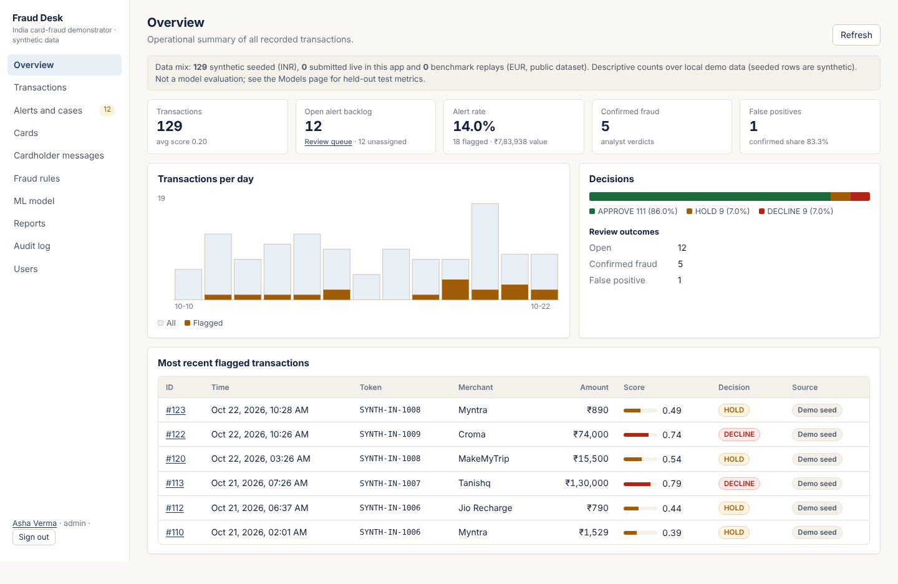

# Fraud Desk — credit card fraud review demonstrator (India)

A Software Engineering Lab project (CIC-357): FastAPI + SQLite back end, React/TypeScript analyst console, a transparent rule engine and an offline-trained ML model. Amounts are in ₹; the synthetic customers, cities, merchants and MCC codes are Indian. Merchant and bank names are illustrative labels on invented data; nothing here is real customer data and no affiliation is implied.

> **Not a payment system.** Card identifiers are synthetic tokens; blocking a token only changes this app's local behaviour. No bank or network integration, no PCI DSS certification, not production-ready.
> **Scoring honesty:** live (Indian) transactions are scored by rules. The ML model was trained on the public ULB/Kaggle benchmark (2013, European cardholders, EUR, anonymised PCA features), so it applies only to transactions carrying those 28 features (benchmark replay). Its measured, held-out results are on the **ML model** page and in `ml/artifacts/*.json`.



## Documentation
| Doc | What it covers |
|---|---|
| [docs/SETUP.md](docs/SETUP.md) | Step-by-step install and run (Windows, macOS, Linux), options, troubleshooting |
| [docs/DEMO.md](docs/DEMO.md) | 6-minute live demo script and likely viva questions |
| [docs/ARCHITECTURE.md](docs/ARCHITECTURE.md) | Layers, request flow, data model, security design |
| [docs/API.md](docs/API.md) | Every endpoint with role and example |
| [docs/lab-alignment.md](docs/lab-alignment.md) | The 13 lab experiments mapped to the code |
| [docs/lab-file/](docs/lab-file) | The practical file (.docx) and the scripts that rebuild it |
| [docs/screenshots/](docs/screenshots) | One screenshot per page |
| [STATUS.md](STATUS.md) | Current verified state and known limits |
| [CHANGELOG.md](CHANGELOG.md) | Version history |

## Quick start (single port, production build)
```bash
python -m venv .venv && source .venv/bin/activate        # Windows: .venv\Scripts\activate
pip install -r requirements.txt -r requirements-ml.txt   # the ML packages are optional: without them the app runs rules-only
(cd frontend && npm install && npm run build)             # skip if frontend/dist is already present
python -m app.cli create-user --email you@example.com --name "Your Name" --role admin   # prompts for a password (min 10 chars)
uvicorn app.main:app --host 127.0.0.1 --port 8000
```
Open http://127.0.0.1:8000. On Windows, `run-demo.ps1` does the same. API docs: `/docs`.
First start creates `fraud_demo.sqlite` with 129 synthetic transactions (14 Indian cardholders, 19 merchants), alerts, cardholder messages and the shipped model.

**Sign-in.** E-mail + password. Optional second step: set `FRAUD_LOGIN_OTP=true` and a 6-digit code is e-mailed (5-minute expiry, 5 attempts, single use). With the default `FRAUD_OTP_DELIVERY=console` the code is printed in the server terminal (development only); set `FRAUD_OTP_DELIVERY=smtp` plus `FRAUD_SMTP_HOST/PORT/USER/PASSWORD/FROM` for real e-mail. SMS/phone OTP is not implemented (it needs a paid provider). **No-login demo:** `FRAUD_AUTH_REQUIRED=false` (everyone is administrator `local-demo`; only on a machine you alone use).

## What is in the app
| Page | Purpose |
|---|---|
| Overview | volume, decisions, backlog, flagged value (₹), outcomes, trend; seeded vs live vs benchmark mix |
| Transactions | search, filters, sort, pagination; submit a synthetic transaction (currency, city, channel) |
| Alerts and cases | queue of holds/declines; assign to me; cardholder response; investigate |
| Transaction page | score broken into factors, cardholder, merchant (MCC, risk), history, audit trail, verdict with confirmation |
| Cards | tokens with cardholder, issuer, status; block/unblock (admin) |
| Cardholder messages | simulated SMS/e-mail outbox with a one-time “Was this you?” link (`/confirm/…`, no sign-in) |
| Fraud rules | thresholds, ₹ high-amount limit, blocked countries, velocity limit; factor catalogue |
| ML model | held-out metrics with caveats, deploy/retire (admin), benchmark replay |
| Reports | counts, fraud rate, false-positive share, analyst productivity, CSV exports |
| Audit log | hash-chained events; **Verify integrity** (admin) |
| Users / Account | admin user management; change own password |

Roles: **analyst** — view, submit, assign to self, record verdicts. **administrator** — also block/unblock, configuration, users, models, replay, audit verification. Enforced by the back end on every request.

## Scoring
`score = 0.04 base + high amount (₹ > limit) 0.35 + blocked country 0.75 + online 0.10 + velocity 0.25 + unusual amount (>5× card average) 0.20 + new country 0.15 + new merchant 0.05 + impossible travel 0.35`, capped at 1 (a negative `score_cap` factor keeps factors summing to the score). With benchmark features and an active model: `1 − (1 − rules)(1 − p)`. `≤ approve_max` APPROVE, `≤ hold_max` HOLD, else DECLINE. Foreign currencies use fixed indicative rates (not live FX). Scoring sits behind a `Scorer` interface (`app/services/scoring.py`).

## Training the model (offline)
Download `creditcard.csv` from Kaggle (ULB MLG; not distributed here) into `data/`, then:
```bash
pip install -r requirements-ml.txt
python -m ml.train --csv data/creditcard.csv --register    # writes ml/artifacts/*, registers a candidate; deploy it on the ML page
```
Protocol: drop exact duplicates; chronological 60/20/20 split; candidates compared on validation PR-AUC; isotonic calibration on the validation split; test split used once. Artifacts are loaded only from `ml/artifacts` after their SHA-256 matches the registry (pickle files can run code).

## Configuration
| Variable | Default | Meaning |
|---|---|---|
| `FRAUD_DB` | `./fraud_demo.sqlite` | SQLite file |
| `FRAUD_AUTH_REQUIRED` | `true` | require sign-in |
| `FRAUD_LOGIN_OTP`, `FRAUD_OTP_DELIVERY`, `FRAUD_SMTP_*` | off, `console` | e-mail one-time code |
| `FRAUD_SECRET_KEY` | generated, stored in DB | token-signing key |
| `FRAUD_CORS_ORIGINS` | Vite dev origins | allowed origins |
| `FRAUD_SEED_DEMO` | `true` | create synthetic demo data on first start |

## Development
```bash
uvicorn app.main:app --reload --port 8000      # API
cd frontend && npm run dev                      # UI on :5173, /api proxied to :8000
```

## Tests
```bash
pip install -r requirements-dev.txt
python -m pytest --cov=app                      # back end
cd frontend && npm test && npm run build        # UI tests, strict tsc, production build
python scripts/collect_results.py               # records measured results for the lab file
```
Last measured run: see `STATUS.md`. Tests use temporary databases and never touch your demo DB.

## Lab file
`docs/lab-file/` rebuilds the practical file from the submitted original: `python docs/lab-file/diagrams.py && python docs/lab-file/build_lab_file.py`. `docs/lab-alignment.md` maps every experiment to the code.

## Security notes and limits
PAN-like values are rejected; no CVV field. Argon2 password hashes; signed 8-hour tokens in `sessionStorage`; sign-in throttling is per account and in memory. Audit log is tamper-evident (hash chain), not tamper-proof. No TLS, password-reset e-mail, MFA beyond the e-mail code, or SMS. SQLite only. Not load-tested. The UI is covered by component tests and was opened page by page in headless Chromium (screenshots in `docs/screenshots/`); there is no automated end-to-end suite and no screen-reader audit.

## Troubleshooting
*Frontend not built* → `cd frontend && npm install && npm run build`. *No account* → `python -m app.cli create-user …` or `FRAUD_AUTH_REQUIRED=false`. *ML page says scikit-learn missing* → `pip install scikit-learn joblib numpy`. *503 / database locked* → another process holds the SQLite file. *Dev UI cannot reach server* → start uvicorn on :8000.
