# Lab alignment — CIC-357 practical experiments 1–13

The syllabus lists 13 practical experiments. These artifacts describe the implemented local demo, with academic design intent distinguished from implemented behavior. The app is a synthetic-data demonstrator with a heuristic baseline; it has no trained classifier, real card data, payment authorization, role-based authentication, external notifications or production deployment.

## 1. Problem statement

Automated suspicious-transaction triage reduces dependence on manual review and rigid static checks. This MVP accepts a synthetic transaction token and transaction attributes, validates them, creates an explainable heuristic score, and returns APPROVE/HOLD/DECLINE. Analysts can record outcomes and administrators can configure cutoffs and blocked countries. It advises only; it does not move funds. The deliverable prioritizes local repeatability and privacy over production throughput/model accuracy.

## 2. Requirements and SRS summary

**Actors:** gateway client (represented by a REST caller or the "Submit synthetic transaction" form), analyst, administrator. **Implemented functional requirements:** validate and score transaction requests with per-factor explanations; persist transactions; list/search/filter/sort/paginate transactions and alerts; transaction investigation view (score factors, token history, audit trail); record fraud/false-positive verdicts once per alert (a second attempt returns 409); block/unblock synthetic tokens (a confirmed-fraud verdict blocks automatically); configure and server-validate thresholds, high-amount, blocked countries and velocity limit; descriptive reports with date/source filters and CSV export; append-only audit log; sign-in with analyst/administrator roles enforced by the backend (Argon2 password hashes, signed expiring tokens, per-user lockout; accounts created with `python -m app.cli create-user`). **Quality constraints implemented:** local setup without Docker, schema validation (PAN-like values rejected), explicit transaction boundaries, versioned schema migrations, synthetic-only identifiers, consistent JSON error shape, security headers and restricted CORS. **Not implemented from the practical-file/SRS target:** trained supervised model (no labelled dataset exists in the repository; none was downloaded), behavioral profile beyond a rolling 24-hour transaction count on the same token, analyst assignment/case queues, cardholder SMS/e-mail/step-up verification, retraining, user-management screens (CLI only), TLS, password reset, multi-factor authentication, performance guarantees, payment authorization, or PCI compliance. The app only advises; a false-positive verdict records a label and does not change the original decision. Config cutoffs must be ordered `approve_max < hold_max`; scores are in [0,1]. **Behaviour changes versus the first version:** velocity is a rolling 24 hours (was same UTC day); approved transactions carry review status `NOT_REQUIRED` and cannot be reviewed; `/api/transactions` and `/api/audit` return paginated objects; transaction `reasons` is a JSON list.

## 3. Function-oriented diagrams

### DFD Level 0
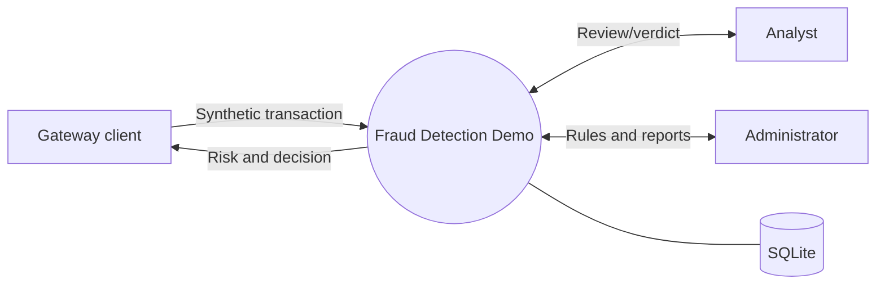

### DFD Level 1
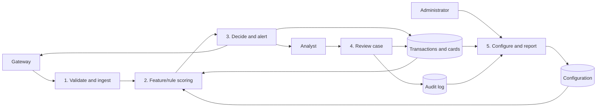

### DFD Level 2 — scoring
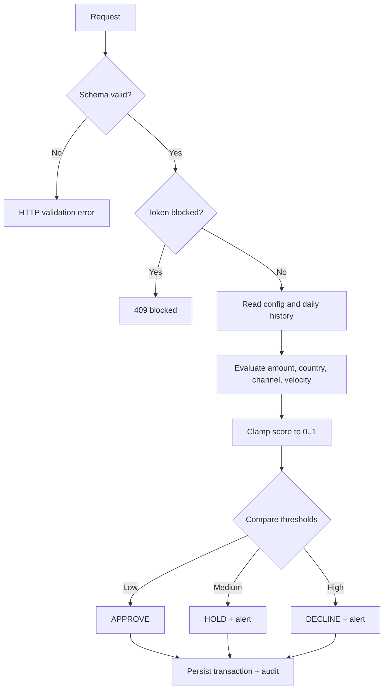

### Structure chart
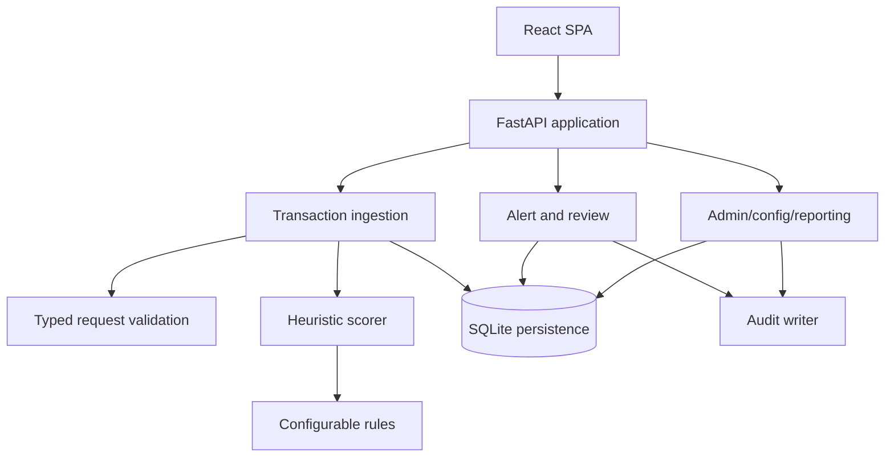

## 4. ER diagram
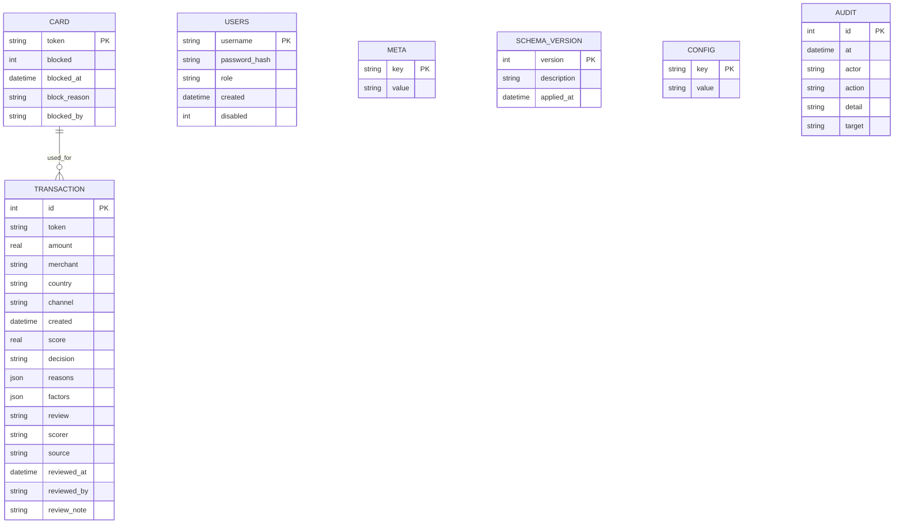

This is a logical relationship: there is no separate alert table. Alerts are the non-APPROVE transaction rows; review status is stored on the transaction (`OPEN`, `CONFIRMED_FRAUD`, `FALSE_POSITIVE`, or `NOT_REQUIRED` for approvals). `source` is `SEED` for synthetic demo rows and `LIVE` for rows submitted through the API. `META` holds the generated token-signing secret and the seed marker. `SCHEMA_VERSION` records applied migrations (currently 2). Foreign keys are not declared between transactions and cards; the link is by token.

## 5. Use case diagram
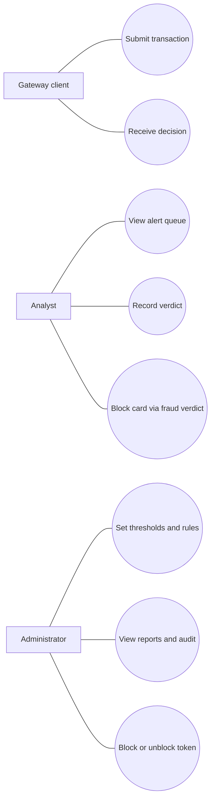

## 6. Class and object diagrams
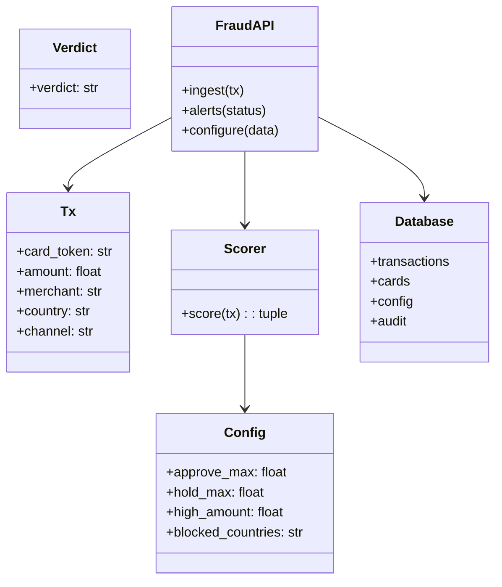

Example object snapshot (synthetic, illustrative seed):
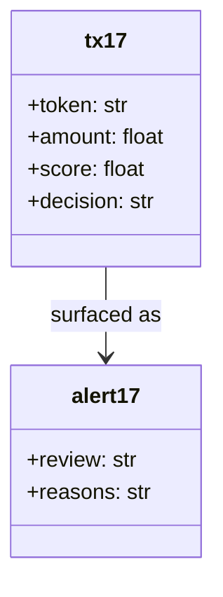

## 7. State-chart and activity diagrams
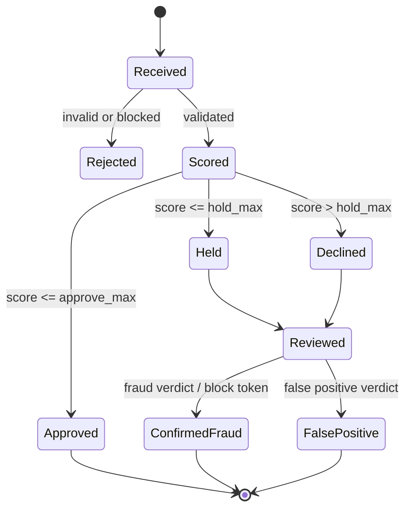

Review status is a one-way state machine enforced by the server inside a database transaction:

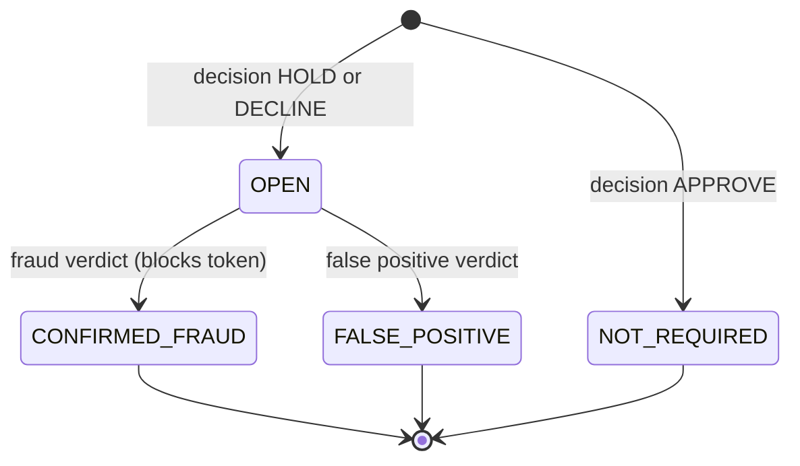

A verdict neither changes the original APPROVE/HOLD/DECLINE value nor can it be changed afterwards (409 `already_reviewed`); reviewing an approval returns 409 `no_alert`. Settlement/release states in the reference are outside this demonstrator.


## 8. Sequence and communication diagrams
```mermaid
sequenceDiagram
 participant G as Gateway client
 participant API as FastAPI
 participant S as Scorer
 participant DB as SQLite
 participant A as Analyst
 G->>API: POST transaction
 API->>API: Validate and check blocked token
 API->>S: score(transaction)
 S->>DB: Read config and rolling 24-hour token history
 DB-->>S: Rules and count
 S-->>API: score, decision, reasons
 API->>DB: Save transaction and audit
 API-->>G: decision response
 A->>API: GET alerts
 API->>DB: Read open cases
 DB-->>API: Cases
 API-->>A: Alert queue
 A->>API: POST verdict
 API->>DB: Save verdict; block token if fraud
 API-->>A: Review result
```

Communication view: `1 Gateway → API: submit`; `2 API → Scorer: evaluate`; `3 API → SQLite: persist`; `4 API → Gateway: decision`; `5 Analyst → API: fetch/review`; `6 API → SQLite: update verdict/card/audit`.

## 9. Component diagram
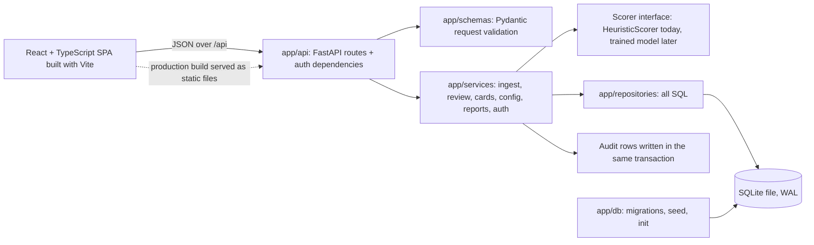

## 10. Deployment diagram
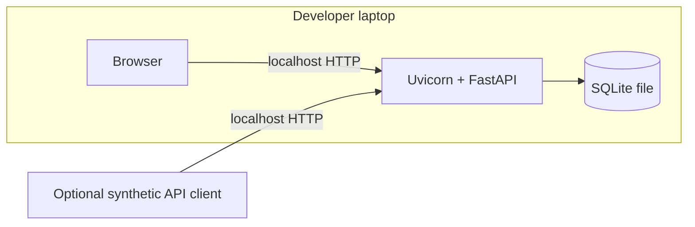

The practical file describes a production-equivalent browser/React, API gateway, application server, model server, Redis and PostgreSQL plus notification provider. Those are not deployed by this MVP. Local HTTP is for localhost demonstration only. For development the Vite server (port 5173) proxies `/api` to Uvicorn (port 8000); for the demo, the `npm run build` output in `frontend/dist` is served by FastAPI itself on one port. The default bind address is 127.0.0.1.

## 11. Testing

Backend (`pytest`): `tests/test_smoke.py` keeps the five original scenarios (ported from a hand-written ASGI client to pytest fixtures; assertions unchanged except the paginated response shape); `test_scoring.py` covers factor points, cap, decision boundaries and swapping the scorer; `test_workflows.py` covers input validation, review state transitions, concurrent reviews, card side effects, configuration, filters/pagination, report arithmetic, CSV formula neutralisation and security headers; `test_db_and_failures.py` covers idempotent init, per-test isolation, in-place migration of a legacy database, 503 on database failure, rollback on a failed audit write and static-file traversal; `test_auth.py` covers 401/403, role enforcement, lockout, hashing and absence of default users. Every test uses its own temporary SQLite file. Frontend (`vitest`): API client error handling, rule-form validation, the investigation flow with confirmation dialog and 409 recovery, role-gated card blocking, and text-only rendering of untrusted values; `npm run build` runs `tsc` in strict mode. Exact counts and results from the last run are recorded in `STATUS.md`. This is functional coverage, not load, penetration, accessibility-audit or model-quality testing. No labelled evaluation dataset exists, so precision/recall/F1/PR-AUC are not measured and the app reports none.

## 12. Function point effort estimate (assumption-based)

Illustrative unadjusted FP estimate using average complexity weights (EI=4, EO=5, EQ=4, ILF=10, EIF=7): inputs: transaction, verdict, config, block/unblock, sign-in = 5 EI (20); outputs: score/decision, reports, alerts, audit, CSV export = 5 EO (25); queries: health, config/rules, cards, review queue, transaction list, transaction detail = 6 EQ (24); internal logical files: transaction, cards, config, audit, users = 5 ILF (50); external interfaces = 0 EIF (0). **Total 119 UFP** (92 before the overhaul). This is a student planning estimate, not measured size; screens and endpoint overlap are simplified. At assumed 10 FP/person-month, effort ≈11.9 person-months; for 2 people ≈6 months before calendar overlap, testing and academic documentation. The local MVP is substantially smaller than this conceptual scope.

## 13. Gantt / PERT timeline

Assumption: two-person student team, 10-week calendar, tasks can partly overlap. Weeks are planning estimates rather than a claim about actual elapsed development.

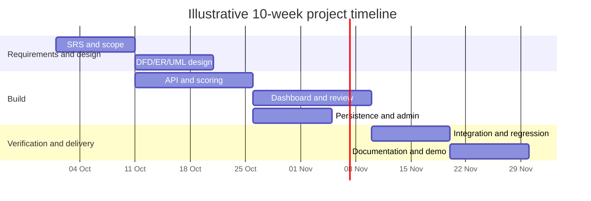

PERT dependency: `Requirements (2w) → Design (2w) → API/scoring (3w) → UI/review (3w) → integration (2w) → final docs/demo (2w)`. Expected critical path is 14 weeks under the assumed serial durations; parallelize persistence/admin and early documentation to target the 10-week calendar. Estimates are illustrative and should be replanned with actual team availability.
