# Lab alignment — CIC-357 practical experiments 1–13

The syllabus lists 13 practical experiments. These artifacts describe the implemented local demo, with academic design intent distinguished from implemented behavior. The app is a synthetic-data demonstrator with a heuristic baseline; it has no trained classifier, real card data, payment authorization, role-based authentication, external notifications or production deployment.

## 1. Problem statement

Automated suspicious-transaction triage reduces dependence on manual review and rigid static checks. This MVP accepts a synthetic transaction token and transaction attributes, validates them, creates an explainable heuristic score, and returns APPROVE/HOLD/DECLINE. Analysts can record outcomes and administrators can configure cutoffs and blocked countries. It advises only; it does not move funds. The deliverable prioritizes local repeatability and privacy over production throughput/model accuracy.

## 2. Requirements and SRS summary

**Actors:** gateway client (represented by a REST caller), analyst workflow, administrator workflow. **Implemented functional requirements:** validate and score transaction requests; persist transactions; list alerts/history; record fraud/false-positive verdicts; block/unblock synthetic tokens; configure amount/country rules and thresholds; expose descriptive counts and an audit log. **Quality constraints implemented:** local setup, schema validation, heuristic reason strings, SQLite persistence, synthetic-only identifiers, HTTP JSON API. **Not implemented from the practical-file/SRS target:** trained supervised model, behavioral profile beyond same-day transaction count, velocity windows other than same-day count, analyst assignment, cardholder SMS/e-mail/step-up verification, retraining, user/role management, TLS/authentication, performance guarantees, payment authorization, or PCI compliance. The app only advises; false-positive review records a label and does not change the original decision. Config cutoffs must be ordered `approve_max < hold_max`; scores are in [0,1].

## 3. Function-oriented diagrams

### DFD Level 0
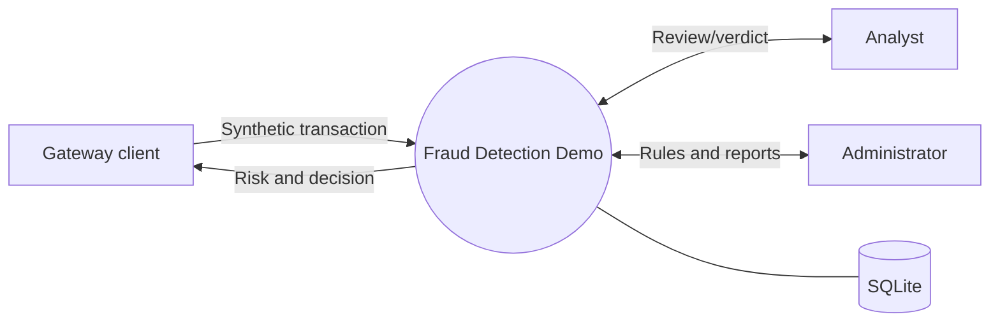

### DFD Level 1
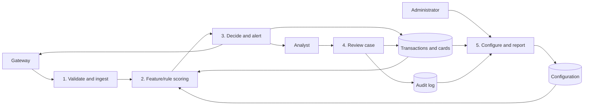

### DFD Level 2 — scoring
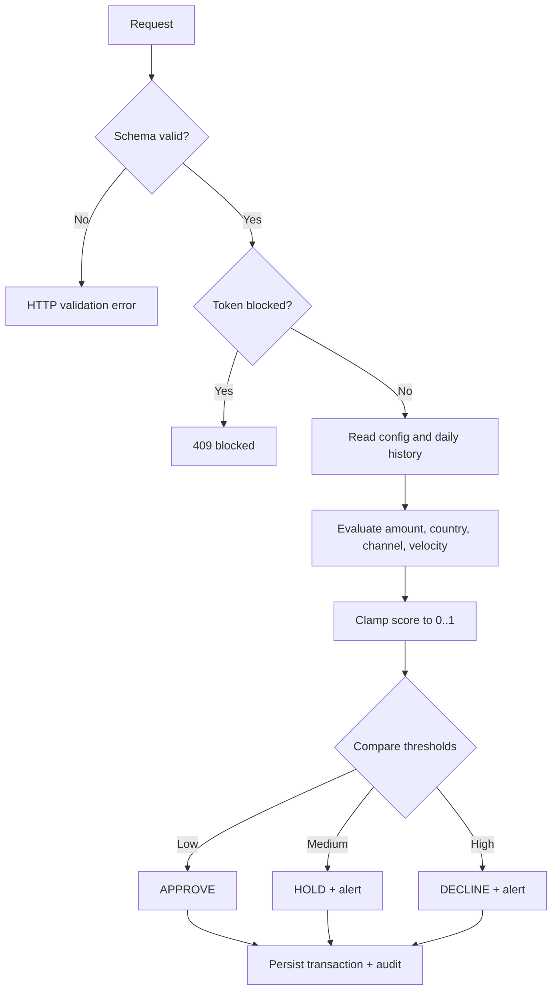

### Structure chart
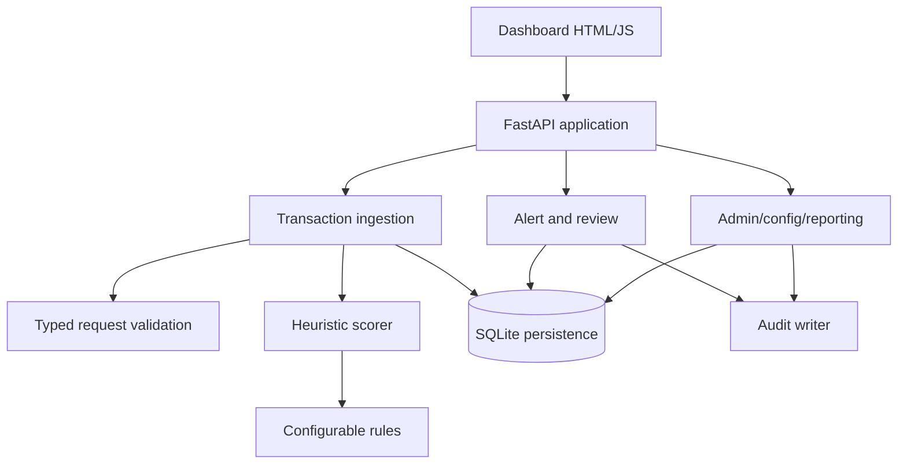

## 4. ER diagram
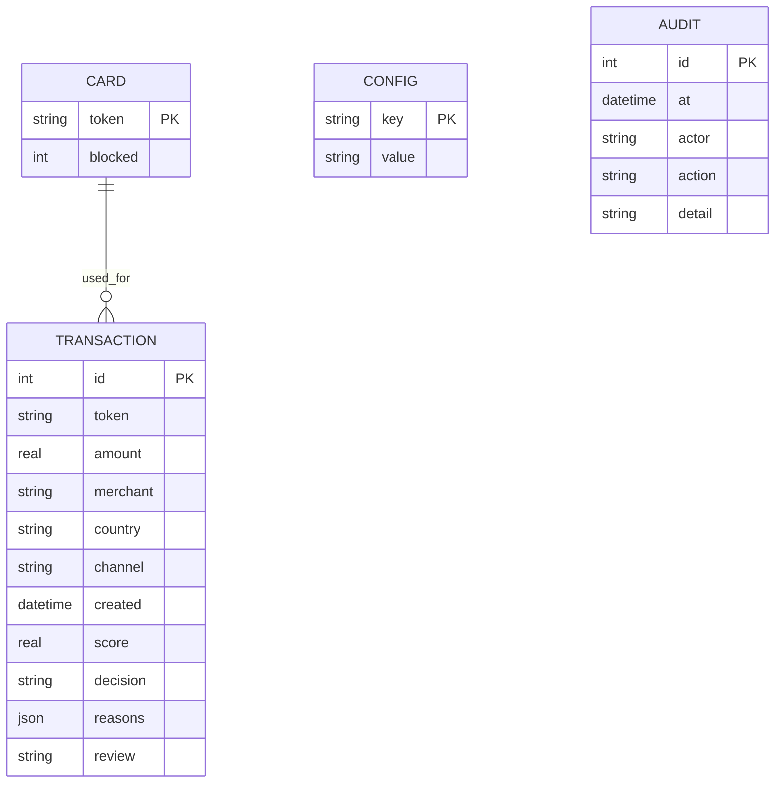

This is a logical relationship: the implementation has no separate alert or user table. Alerts are the non-APPROVE transaction rows; review status is stored on the transaction. The schema also has no explicit foreign-key constraint.

## 5. Use case diagram
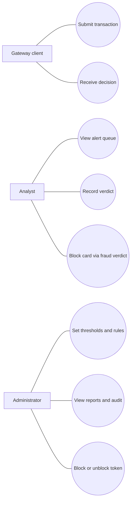

## 6. Class and object diagrams
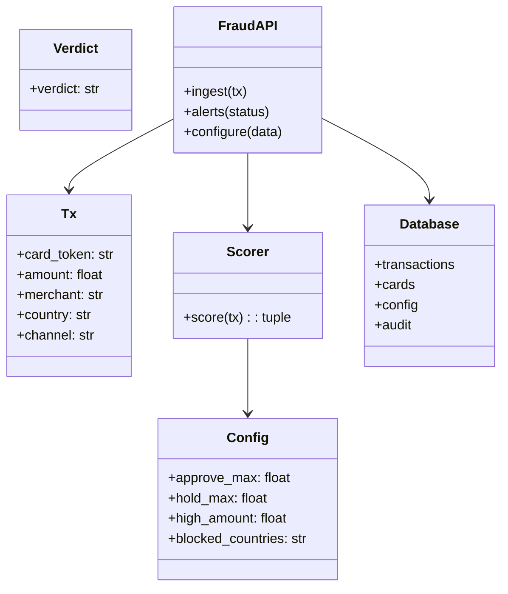

Example object snapshot (synthetic, illustrative seed):
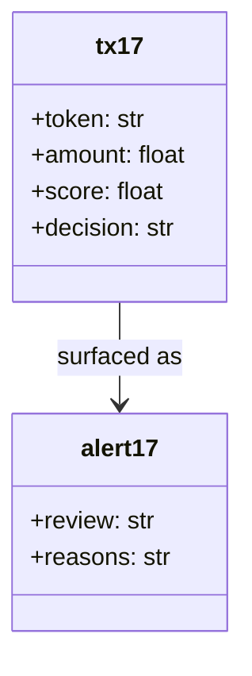

## 7. State-chart and activity diagrams
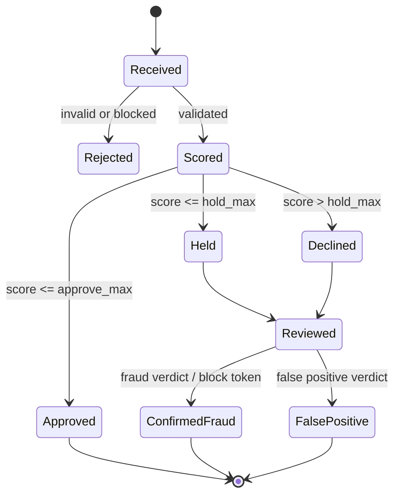

The implemented review verdict is stored as `CONFIRMED_FRAUD` or `FALSE_POSITIVE`; neither transition changes the original APPROVE/HOLD/DECLINE value. A confirmed-fraud verdict blocks the token. Settlement/release states in the reference are outside this demonstrator.

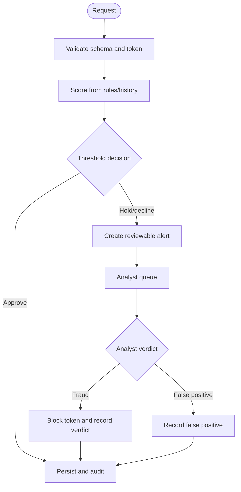

## 8. Sequence and communication diagrams
```mermaid
sequenceDiagram
 participant G as Gateway client
 participant API as FastAPI
 participant S as Scorer
 participant DB as SQLite
 participant A as Analyst
 G->>API: POST transaction
 API->>API: Validate and check blocked token
 API->>S: score(transaction)
 S->>DB: Read config and same-day token history
 DB-->>S: Rules and count
 S-->>API: score, decision, reasons
 API->>DB: Save transaction and audit
 API-->>G: decision response
 A->>API: GET alerts
 API->>DB: Read open cases
 DB-->>API: Cases
 API-->>A: Alert queue
 A->>API: POST verdict
 API->>DB: Save verdict; block token if fraud
 API-->>A: Review result
```

Communication view: `1 Gateway → API: submit`; `2 API → Scorer: evaluate`; `3 API → SQLite: persist`; `4 API → Gateway: decision`; `5 Analyst → API: fetch/review`; `6 API → SQLite: update verdict/card/audit`.

## 9. Component diagram
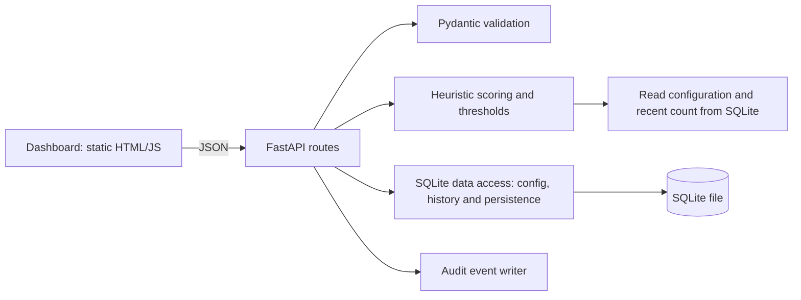

## 10. Deployment diagram
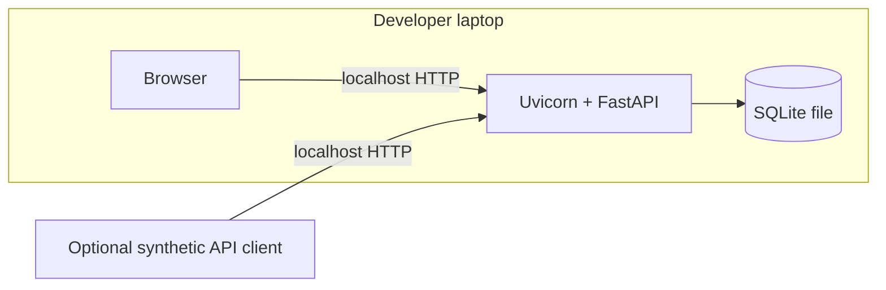

The practical file describes a production-equivalent browser/React, API gateway, application server, model server, Redis and PostgreSQL plus notification provider. Those are not deployed by this MVP. Local HTTP is for localhost demonstration only.

## 11. Testing

`tests/test_smoke.py` contains five API integration tests that call the FastAPI ASGI app directly and create a fresh SQLite file in the OS temporary directory for each test. The suite requires the declared FastAPI/Starlette/Pydantic dependencies, but no HTTP test-client package or separately running server. Last verified command: `python -m unittest discover -s tests -v`; **5 tests passed** (2026-10-20). Covered: dashboard/health, validation and threshold ordering, score range and persistence, analyst verdicts, fraud-triggered token block, blocked-token rejection, false-positive persistence, admin block/unblock and audit. This is functional smoke coverage, not exhaustive unit, system, load, security, model-quality or accuracy testing. No labelled evaluation dataset exists, so precision/recall/F1/PR-AUC are not measured. The tests do not claim to cover every individual rule branch or frontend interaction.

## 12. Function point effort estimate (assumption-based)

Illustrative unadjusted FP estimate using average complexity weights (EI=4, EO=5, EQ=4, ILF=10, EIF=7): inputs: transaction, verdict, config, block/unblock = 4 EI (16); outputs: score/decision, reports, history/alerts, audit = 4 EO (20); queries: health/config/cards/queue = 4 EQ (16); internal logical files: transaction, cards, config, audit = 4 ILF (40); external interfaces = 0 EIF (0). **Total 92 UFP.** This is a student planning estimate, not measured size; screens and endpoint overlap are simplified. At assumed 10 FP/person-month, effort ≈9.2 person-months; for 2 people ≈4.6 months before calendar overlap, testing and academic documentation. The local MVP is substantially smaller than this conceptual scope.

## 13. Gantt / PERT timeline

Assumption: two-person student team, 10-week calendar, tasks can partly overlap. Weeks are planning estimates rather than a claim about actual elapsed development.

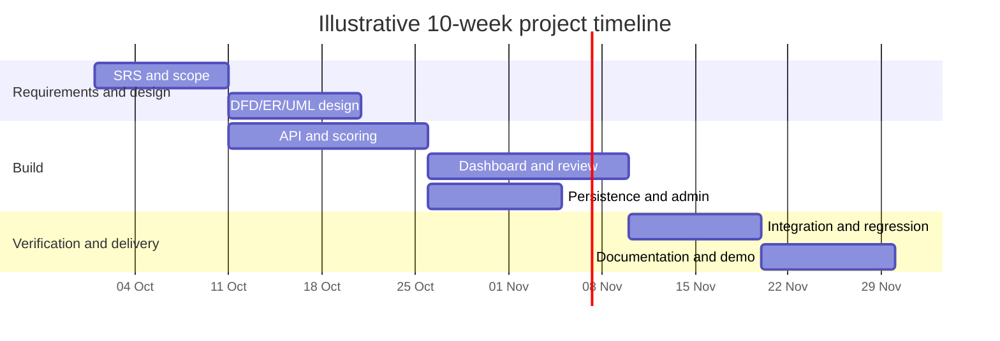

PERT dependency: `Requirements (2w) → Design (2w) → API/scoring (3w) → UI/review (3w) → integration (2w) → final docs/demo (2w)`. Expected critical path is 14 weeks under the assumed serial durations; parallelize persistence/admin and early documentation to target the 10-week calendar. Estimates are illustrative and should be replanned with actual team availability.
